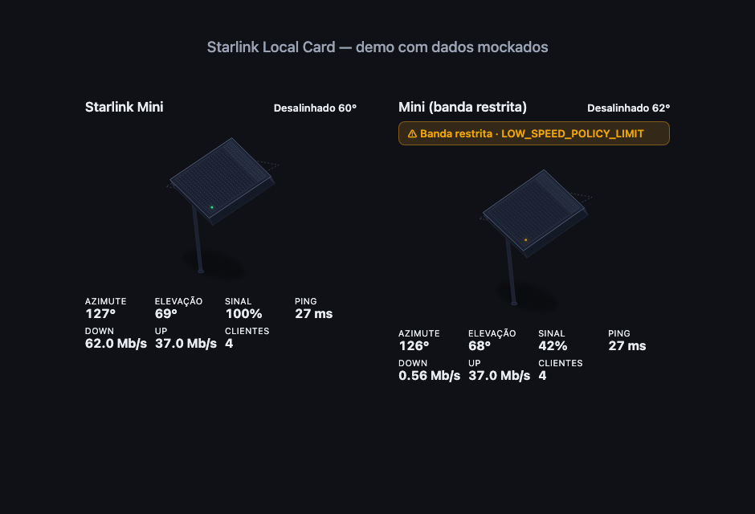

<h1 align="center">Starlink Local Card</h1>

<p align="center">
  <a href="https://github.com/hacs/integration"></a>
  <a href="https://github.com/hudsonbrendon/ha-starlink-local-card/actions/workflows/validate.yml"></a>
  <a href="LICENSE"></a>
</p>

An **isometric Starlink Mini** Lovelace card that comes alive with the
[`starlink_local`](https://github.com/hudsonbrendon/ha-starlink-local) integration:
the phased-array panel tilts to the dish's real **azimuth/elevation**, a dashed
ghost shows the **desired** aim, the array brightens with **signal quality**, and
an amber badge lights up when the dish reports **bandwidth restriction**.

<p align="center"></p>

## Features

- 🛰️ Faithful Starlink **Mini** drawn as an isometric phased-array panel on its fold-out kickstand.
- 🎯 Panel **tilts to the live azimuth/elevation**, eased smoothly; a dashed **ghost** marks the desired aim and the header shows how far off (`Alinhado` / `Desalinhado N°`).
- 📶 Array glow scales with **signal quality**; status LED turns amber on restriction.
- 🐢 **Bandwidth-restricted** badge with the reason (e.g. `LOW_SPEED_POLICY_LIMIT`).
- 📊 Footer readout: azimuth, elevation, signal, ping, downlink, uplink, WiFi clients.
- 🎨 Self-contained SVG (no runtime deps), light/dark aware, scales to phone width.
- 🔍 **Auto-discovers** its entities from the `starlink_local` platform — usually zero config.

## Installation

### HACS

1. HACS → ⋮ → **Custom repositories** → add `https://github.com/hudsonbrendon/ha-starlink-local-card`, category **Dashboard**.
2. Install **Starlink Local Card**.
3. Add the card to a dashboard (it appears in the card picker).

### Manual

Copy `ha-starlink-local-card.js` to `config/www/` and add a dashboard resource:

```yaml
url: /local/ha-starlink-local-card.js
type: module
```

## Usage

Zero-config — it finds the `starlink_local` entities on its own:

```yaml
type: custom:starlink-local-card
```

With overrides:

```yaml
type: custom:starlink-local-card
title: Antena Starlink
entities:
  azimuth: sensor.starlink_dish_antenna_azimuth
  elevation: sensor.starlink_dish_antenna_elevation
  desired_azimuth: sensor.starlink_dish_desired_azimuth
  desired_elevation: sensor.starlink_dish_desired_elevation
  signal: sensor.starlink_dish_signal_quality
  obstruction: sensor.starlink_dish_fraction_obstructed
  restricted: binary_sensor.starlink_dish_bandwidth_restricted
  dl_reason: sensor.starlink_dish_downlink_restriction_reason
  pop_ping: sensor.starlink_dish_pop_ping_latency
  downlink: sensor.starlink_dish_downlink_throughput
  uplink: sensor.starlink_dish_uplink_throughput
  clients: sensor.starlink_router_wifi_clients
```

## Credits

Built by [@hudsonbrendon](https://github.com/hudsonbrendon). The isometric look
follows the [anatomy](https://github.com/wheresryan22/anatomy) method; the
renderer here is a self-contained subset. Companion to the
[Starlink Local integration](https://github.com/hudsonbrendon/ha-starlink-local).

## License

MIT
