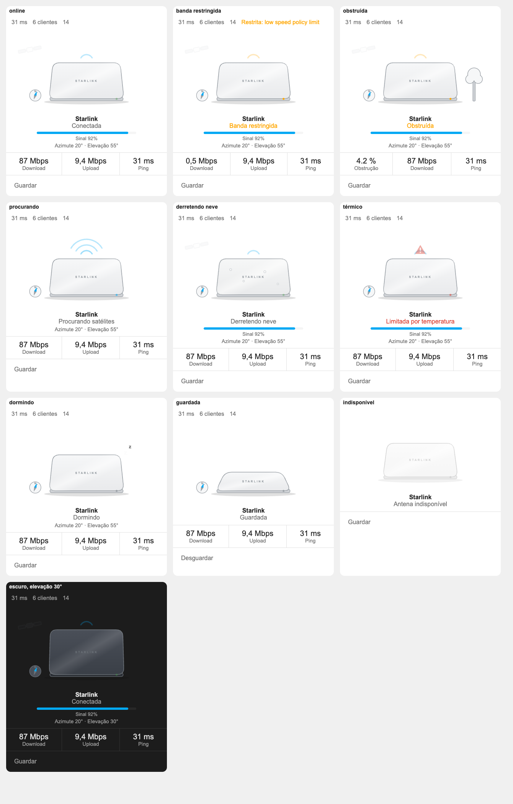

# Starlink Local Card

[](https://hacs.xyz)
[](https://github.com/hudsonbrendon/ha-starlink-local-card/releases)
[](https://github.com/hudsonbrendon/ha-starlink-local-card/actions/workflows/lint.yml)

Lovelace card for a Starlink dish running the
[Starlink Local integration](https://github.com/hudsonbrendon/ha-starlink-local)
(local gRPC, dish + router). Same layout and minimal grey / white drawing as
the vacuum, HP printer and Intelbras solar cards: tips row, animated
illustration, name + status, stats and a toolbar.

- **Animated dish**: a Starlink Mini reclined to the real elevation, a compass
  needle on the azimuth (dashed line on the desired azimuth), signal waves
  pulsing up and a satellite crossing the sky while connected. Amber waves
  when bandwidth is restricted or alerts are active, a tree in the way and
  stuttering waves when obstructed, faint waves and a blinking LED while
  searching, warm glow and melting snow when heating, red LED + warning on
  thermal throttling, "z z" when sleeping, flat when stowed, greyed out when
  unavailable. Respects `prefers-reduced-motion` and dark mode.
- **Tips**: PoP ping, Wi-Fi clients, GPS satellites and the restriction reason.
- **Signal bar** (signal quality) and alignment (azimuth / elevation).
- **Stats** per state: download / upload (Mbps) / ping; obstruction first when
  obstructed. Configurable.
- **Toolbar**: obstruction map; with Home Assistant's built-in
  [Starlink integration](https://www.home-assistant.io/integrations/starlink/)
  also stow / unstow and reboot (both with confirmation), and its heating,
  sleep and thermal sensors drive the states above. Works with the built-in
  integration alone too.



## Installation

1. HACS → Frontend → ⋮ → *Custom repositories* → add
   `https://github.com/hudsonbrendon/ha-starlink-local-card` as *Dashboard*.
2. Install **Starlink Local Card**. HACS adds the resource automatically.

Manual: copy `dist/ha-starlink-local-card.js` to `config/www/` and add
`/local/ha-starlink-local-card.js` as a JavaScript module resource.

## Configuration

```yaml
type: custom:starlink-local-card
device: 2851588888…   # the "Starlink Dish" device (pick it in the visual editor)
```

| Option | Default | Description |
| --- | --- | --- |
| `device` | — | Device id of the dish. Router entities of the same entry are found automatically. |
| `entities` | — | Explicit overrides per key (`downlink`, `uplink`, `pop_ping`, `signal_quality`, `obstruction`, `azimuth`, `elevation`, `clients`, `stowed`, `reboot`...). Without `device`, `entities.downlink` or `entities.pop_ping` is required. |
| `name` | device name | Title shown under the illustration. |
| `show_name` / `show_status` / `show_toolbar` | `true` | Toggle sections. |
| `compact_view` | `false` | Hide the illustration and stats. |
| `language` | HA language | Force `en` or `pt-BR`. |
| `stats` | see above | Per-state list (`default`, `online`, `obstructed`...) of `{ key \| entity, attribute, unit, subtitle }`. |
| `shortcuts` | `[]` | Extra toolbar buttons `{ name, icon, service, service_data, target }`. |

0.1.x configs (`title`, `entities.signal`, `entities.restricted`,
`entities.dl_reason`) keep working.

## Development

```bash
npm install
npm run build      # dist/ha-starlink-local-card.js
npm test           # vitest
npm run lint && npm run typecheck
```

## License

MIT
